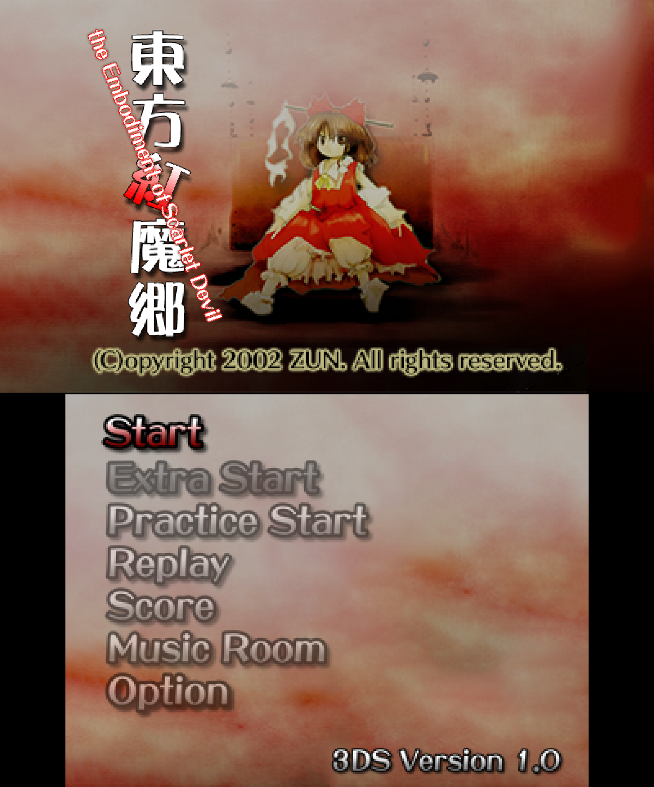
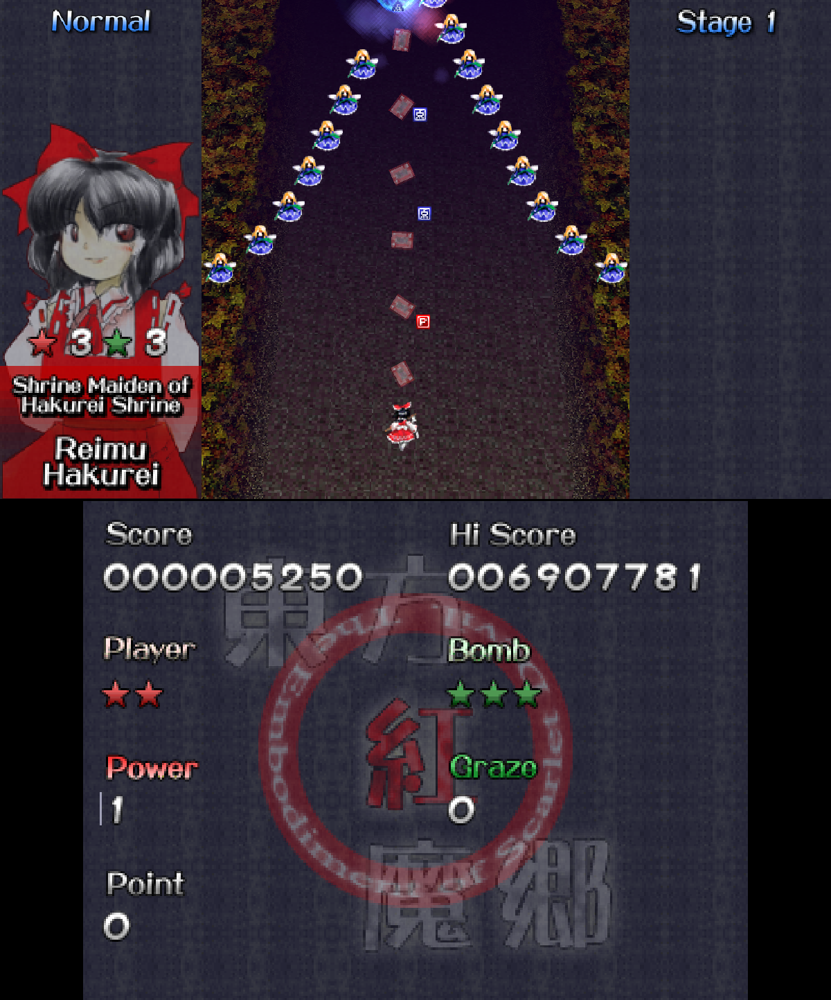
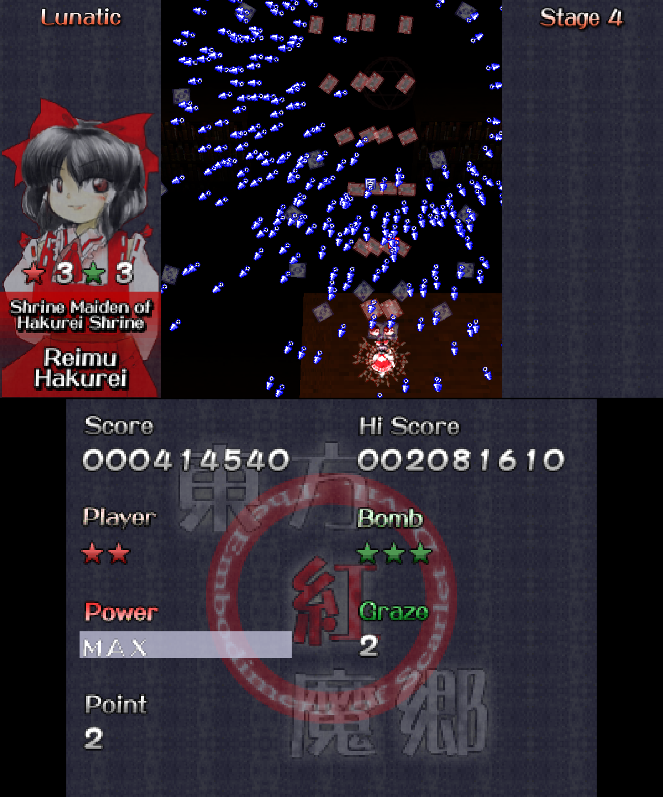
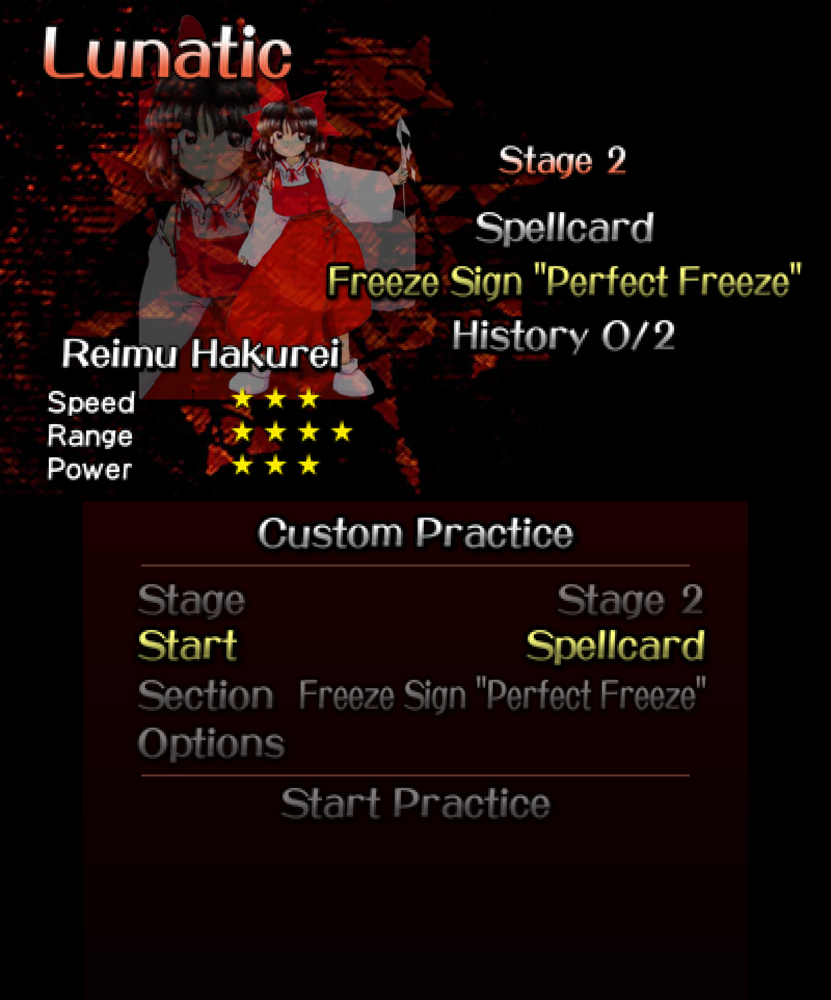
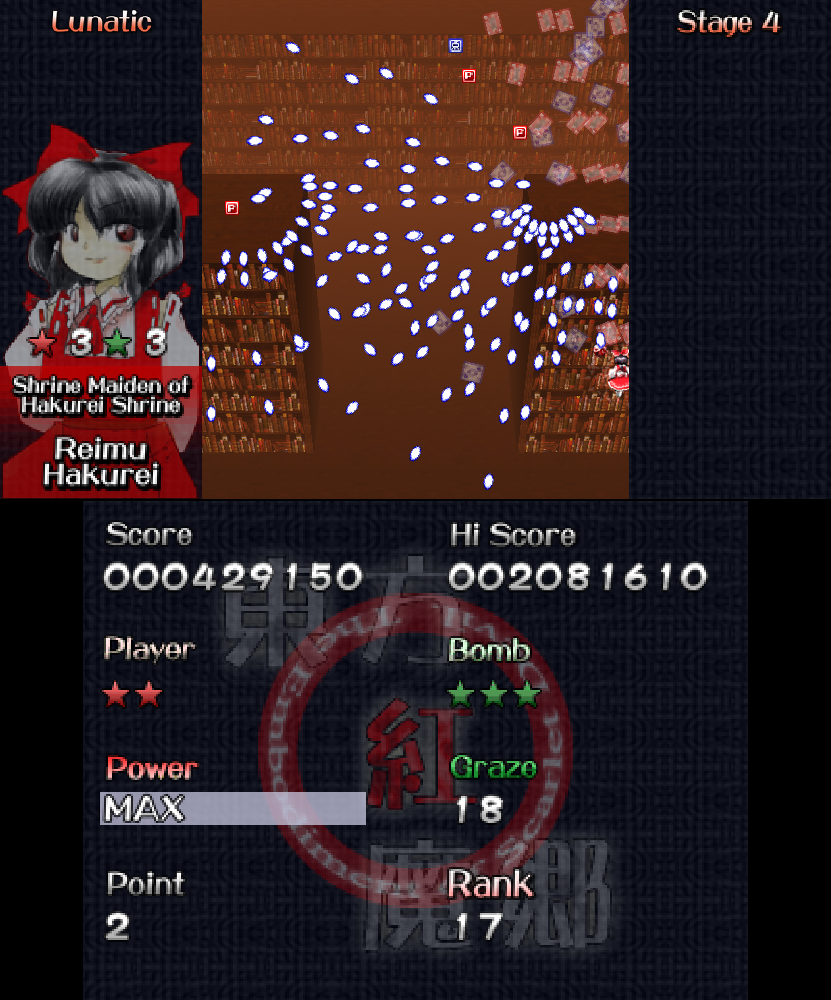
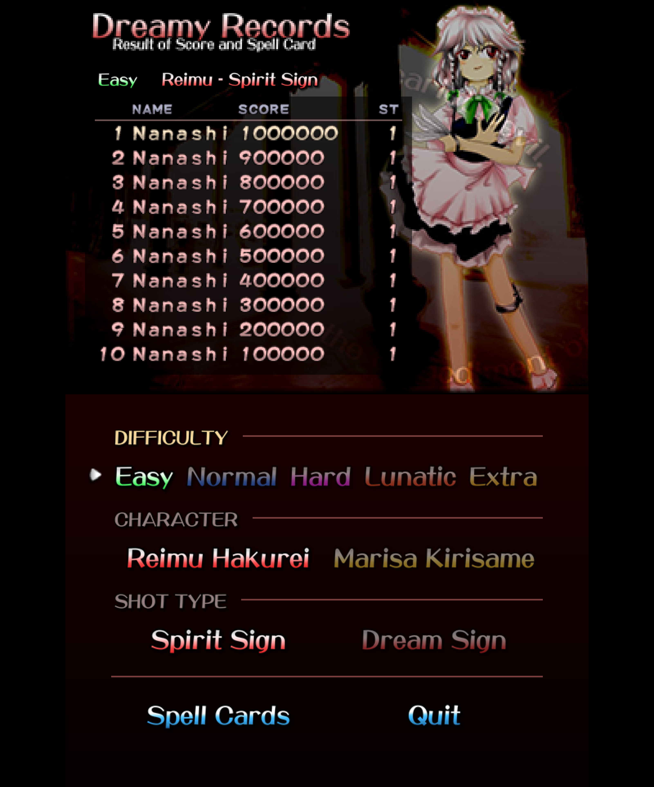

# Touhou 6 for the 3DS

A Nintendo 3DS port of **Touhou Koumakyou ~ the Embodiment of Scarlet Devil** with additional quality-of-life features, based on [GensokyoClub/th06](https://github.com/GensokyoClub/th06).

Compatible with both **Old and New Nintendo 3DS and 2DS**.

You'll need the original PC game files or the Steam Classic version. The included Windows converter prepares them for the 3DS.

## Features

- Integrated **EoSD Retexture Pack v0.3**, with selectable original/retextured graphics and Old/New player sprites.
- Original, PCB, IN, and SA sound sets.
- Toggle shooting and focus, plus remappable controls.
- Adjustable **Point of Collection** behavior: collect at max power only, or at any power.
- Optional circular boss health bars, focus hitbox indicator, and sidebar life/bomb counters.
- English/Japanese language selection, including translated dialogue and endings.

See [new features and settings](docs/features.md).

## Screenshots

  
  
  

  
  
  

Screenshots taken in Azahar.

## Requirements

- A homebrew-enabled 3DS or 2DS.
- The original Japanese TH06 1.02h or [Touhou Koumakyou: Classic - the Embodiment of Scarlet Devil](https://store.steampowered.com/app/4924840/). Hard patched versions (those which have had their original files overwritten) are not supported.
- A Windows 10 or 11 PC to run the converter.
- DSP firmware dumped on your console for audio. See [3DS Hacks Guide](https://3ds.hacks.guide/finalizing-setup.html).

## Installation

1. Download `TH06-Asset-Converter.exe` and either `th06.3dsx` or `th06.cia` from the [latest release](https://github.com/ItsPoofy/th06-3ds/releases/latest).
2. Run the converter from a writable folder on your PC.
3. Select your TH06 game folder containing the DAT archives and `bgm`. For Steam Classic, select `th06c`.
4. Wait for **Assets ready**. The converter creates an `assets` folder beside the executable.
5. Place that folder at `/3ds/th06/assets/` on your SD card. You can transfer files by inserting the SD card into your PC or wirelessly using [FTPD](https://github.com/mtheall/ftpd).

- **3DSX:** Copy `th06.3dsx` to `/3ds/th06/` and launch Touhou 6 from Homebrew Launcher.
- **CIA:** Copy `th06.cia` to your SD card and install it with FBI. You can also install directly through FBI’s **Remote Install > Scan QR Code** using the download QR code. Launch Touhou 6 from the home menu.

## Controls

| Input | Default action |
| --- | --- |
| D-pad / Circle Pad | Move |
| A | Shoot / confirm |
| B | Bomb / back |
| L | Focus |
| X | Skip dialogue |
| START | Pause |

Change bindings in **Options > Controls > Key Config**.

## Bugs

Report problems in [Issues](https://github.com/ItsPoofy/th06-3ds/issues). Include your console model, release version, whether you use CIA or 3DSX, and what happened. For crashes, attach `/3ds/th06/startup.log` and a Luma crash dump if available.

## Building

See [Build from source](docs/build.md).

## Credits

- **ZUN / Team Shanghai Alice** — original game.
- **[GensokyoClub/th06](https://github.com/GensokyoClub/th06)** — original reimplementation.
- **ItsPoofy** — 3DS port.
- **Emarrel** — EoSD Retexture Pack v0.3.
- **[Touhou Patch Center](https://www.thpatch.net/wiki/Touhou_Patch_Center:Main_page)** — English translation.
